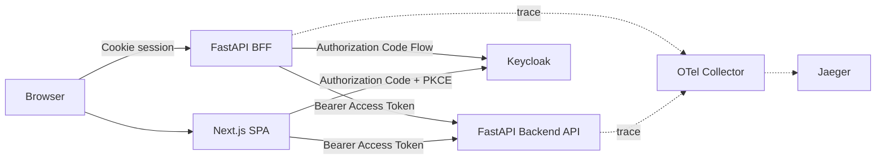

# oidc-keycloak-lab

Keycloak、FastAPI、Next.js を使い、OIDC / OAuth 2.0 の認証・認可を手を動かしながら学ぶためのラボリポジトリです。

BFF と SPA の両構成を実装し、ログインの正常系だけでなく、token 検証、session、logout、観測性まで含めて「どこで何を信頼するか」を確認できる構成にしています。

> このリポジトリは学習・検証用です。production ready な認証基盤としての利用は想定していません。

このリポジトリをコードと公開ドキュメントの唯一の編集元として扱います。調査途中のメモや秘密情報はコミットせず、再利用する内容だけを整理して `docs/` に反映します。

## Architecture



- BFF 構成では、ブラウザに token を渡さず、Cookie session を使ってログイン状態を管理します。
- SPA 構成では、Authorization Code Flow + PKCE を使い、Access Token をブラウザのメモリ上に保持します。
- Backend API は Keycloak の JWKS を使い、受け取った Access Token を独立して検証します。

詳細は [Auth Flow Architecture](docs/Reference/02_AuthFlowArchitecture.md) を参照してください。

## Implemented Features

- Keycloak を OpenID Provider とした Authorization Code Flow
- FastAPI BFF と Backend API の分離
- Access Token の署名、`iss`、`aud`、`exp` 検証
- JWKS キャッシュと、署名鍵ローテーションを想定した再取得
- Realm Role を使った認可
- Next.js SPA による Authorization Code Flow + PKCE（S256）
- Access Token のメモリ保持
- BFF における Refresh Token を使った Access Token 更新
- BFF における RP-Initiated Logout と Back-Channel Logout
- JWT 改ざん、`alg=none`、不正な `kid`、期限切れなどの異常系テスト
- OpenTelemetry による BFF / Backend API 間の trace context 伝搬
- Collector の redaction processor と Jaeger による認証フローの可視化
- CI によるRuff、mypy、pytest、SPA本番ビルド、npm依存監査の実行

## Security Focus

このラボでは、機能を動かすことに加えて、次の境界をコードとログで確認しています。

- ID Token と Access Token の用途の違い
- Resource Server が `iss` と `aud` を検証する理由
- logout と Keycloak session の関係
- trace に token や PII を残さないための観測性設計

今後は、次のテーマを優先して整理します。

- `state`、`nonce`、ID Token 検証と、ライブラリが担う検証範囲
- BFF session と Access Token / Refresh Token の lifetime
- BFF Cookie の `Secure`、`HttpOnly`、`SameSite` と CSRF 対策
- Realm Role と Client Role の設計判断

詳細な作業順は [ROADMAP.md](ROADMAP.md) を参照してください。

## Quick Start

前提として Docker Desktop、Python 3.12、Node.js 20.9以上を使用します。

```bash
# 1. Keycloak + PostgreSQL
cd infra/keycloak
docker compose up -d

# 2. Backend API
cd ../../apps/demo_api
python -m venv .venv
source .venv/bin/activate
pip install -r requirements.txt
cp .env.example .env
uvicorn main:app --reload --port 8001

# 3. BFF（別ターミナル）
cd apps/demo_bff
python -m venv .venv
source .venv/bin/activate
pip install -r requirements.txt
cp .env.example .env
# .env の OIDC_CLIENT_SECRET などを Keycloak の設定値に合わせる
uvicorn main:app --reload --port 8000
```

ブラウザで `http://localhost:8000/login` にアクセスします。Keycloak の realm / client / user の作成は [04_SetupKeycloak.md](docs/04_SetupKeycloak.md)、起動パターン全体は [Local Startup](docs/Reference/01_LocalStartup.md) を参照してください。

SPA を起動する場合は、`apps/demo_web_spa/.env.local.example` を `.env.local` にコピーして `npm install`、`npm run dev` を実行します。詳細は [11_SetupNextJsSPAWithPKCE.md](docs/11_SetupNextJsSPAWithPKCE.md) を参照してください。

## Security Notes

- `.env` と `.env.local` は Git 管理外です。コミットする設定例には実際の秘密情報を含めません。
- `infra/keycloak/.env` の値を含め、ローカル検証用の設定を本番環境へ流用しないでください。
- BFF は Access Token を Cookie に直接載せず、サーバー側 session に保持します。
- CORS、Cookie属性、token lifetimeなどはローカル学習を優先した設定であり、本番向けのセキュリティ要件を満たすとは限りません。

## Documentation

- `docs/`: 順番に進める Setup 手順
- `docs/Reference/`: 用語、アーキテクチャ、切り分け観点、共通手順
- `apps/`: BFF、Backend API、SPAの検証実装
- `infra/`: Keycloak、PostgreSQL、OTel Collector、Jaegerの起動構成
- `scripts/`: ローカル検証用の補助スクリプト

主なReference：

- [Glossary](docs/Reference/00_Glossary.md)
- [Local Startup](docs/Reference/01_LocalStartup.md)
- [Auth Flow Architecture](docs/Reference/02_AuthFlowArchitecture.md)
- [Troubleshooting](docs/Reference/03_Troubleshooting.md)
- [Token Claims and Validation](docs/Reference/05_TokenClaimsAndValidation.md)
- [Public Client and PKCE](docs/Reference/08_PublicClientAndPKCE.md)
- [Observability](docs/Reference/09_Observability.md)

## License

[MIT](LICENSE)
