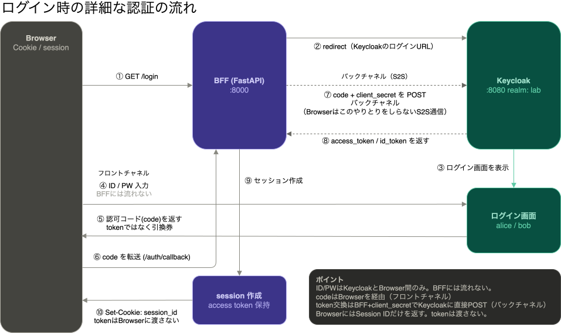
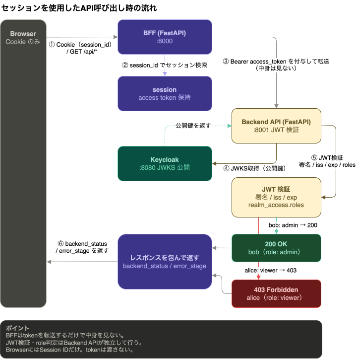

# 02 Auth Flow Architecture

## 目的

このドキュメントは、この repo で扱っている Browser、Keycloak、BFF、Backend API の役割分担と認証フローを整理するものである。

------

## 構成全体

- Browser
- Keycloak
- BFF (`apps/demo_bff/`)
- Backend API (`apps/demo_api/`)

この repo では、Browser は BFF と Cookie ベースでやり取りし、BFF は Keycloak から受け取った access token を Backend API へ Bearer token として転送する。

```text
Browser
  -> BFF (/login, /me, /api/*)
  -> Keycloak (login, logout)

BFF
  -> Keycloak (authorization, token, logout)
  -> Backend API (/me, /admin-data)

Backend API
  -> Keycloak の JWKS / issuer 情報を使って JWT を検証
```

------

## 登場要素の役割

- Browser
  - ログイン開始、画面表示、Cookie 送信を行う
- Keycloak
  - 認証、認可コード発行、token 発行を行う
- BFF
  - 認可コードフローを開始し、callback で token を受け取る
  - session を保持し、Backend API へ access token を渡す
- Backend API
  - Bearer token を受け取り、JWT の検証と role 判定を行う

------

## Authorization Code Flow の流れ

1. Browser から BFF の `/login` を開く
2. BFF が Keycloak の認可 endpoint へリダイレクトする
3. Keycloak でユーザー認証を行う
4. Keycloak が認可コードを BFF の `/auth/callback` へ返す
5. BFF が認可コードを使って token を取得する
6. BFF が session を作成し、以後は Browser と Cookie ベースでやり取りする

もう少し細かく見ると、次の 2 本の経路に分かれる。

- フロントチャネル
  - Browser と Keycloak のリダイレクト
  - `/login` からログイン画面、`/auth/callback` までの移動
- バックチャネル
  - BFF と Keycloak のサーバ間通信
  - 認可コードを token に交換する通信

この切り分けを持っておくと、`redirect_uri` 不一致はフロントチャネル、`client secret` 不一致はバックチャネル寄りの失敗だと見分けやすい。



------

## Session と Access Token の役割分担

- session
  - Browser と BFF の間でログイン状態を保つ
- access token
  - BFF から Backend API へユーザー情報と認可情報を渡す

つまり、Browser は token を直接扱わず、Backend API は Cookie を見ずに token だけを検証する。

今回の repo での見え方は次のとおり。

- `/me`
  - BFF が session からログイン状態を見て返す
- `/api/me`
  - BFF が access token を Backend API に渡し、Backend API が JWT を検証して返す

見た目は似ていても、`/me` は BFF 側の状態確認、`/api/me` は API 側の token 検証結果という違いがある。



------

## 認可コードは何のためにあるか

認可コードは、ブラウザ経由で直接 token を渡さずに、BFF が後から安全に token 交換するための中継値である。

- Browser には一時的なコードだけ返す
- 本物の token は BFF がバックチャネルで受け取る

この構成により、token の扱いを BFF 側へ寄せやすくなる。

------

## BFF を置く理由

- Browser に access token を直接持たせない構成を試せる
- Keycloak とのやり取りを BFF 側に集約できる
- Backend API には Bearer token 検証だけを集中させやすい

この repo では、BFF を置くことで次の 2 つを分けて観察できる。

- 認証まわり
  - `/login`、`/auth/callback`、session、logout
- API 保護まわり
  - Bearer token、JWT 検証、role 判定

そのため、`docs/05` は認証の入口、`docs/06` は API 保護へ進む段階として読み分けやすい。

------

## 失敗系をどこで見るか

失敗系は、どのフェーズで止まったかを見ると追いやすい。

- `/login` 前後で止まる
  - Keycloak 到達失敗や `redirect_uri` 不一致を疑う
- `/auth/callback` 前後で止まる
  - token 交換失敗や `client secret` 不一致を疑う
- `/api/*` で止まる
  - Backend API 到達性や JWT 検証、role 判定を疑う

この切り分けは [03_Troubleshooting.md](/Users/tororu/workspace/labs/iam-lab-study/docs/Reference/03_Troubleshooting.md) で詳しく扱う。

------

## この repo での現在のスコープ

- `docs/05` では BFF 単体の OIDC ログインと role 差分確認まで扱う
- `docs/06` では BFF と Backend API を分離し、JWT 検証付き API 保護まで扱う
- `aud` 検証、token lifecycle、Next.js 連携は次段階のテーマとする

------

## 関連ドキュメント

- [05_SetupFastAPI-OIDCLogin.md](/Users/tororu/workspace/labs/iam-lab-study/docs/05_SetupFastAPI-OIDCLogin.md)
- [06_SetupFastAPI-BackendAPI.md](/Users/tororu/workspace/labs/iam-lab-study/docs/06_SetupFastAPI-BackendAPI.md)
