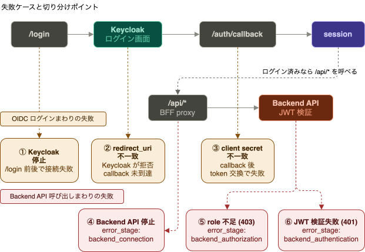

# 03 Troubleshooting

## 目的

このドキュメントは、Keycloak、BFF、Backend API の検証中によくある失敗例と、切り分けの見方を整理するものである。

------

## 切り分けの基本方針

最初に、どこで失敗しているかを切り分ける。

- Keycloak へ到達できないのか
- BFF の `/login` までは動くのか
- `/auth/callback` まで到達しているのか
- Backend API 呼び出しで失敗しているのか

ブラウザの表示だけでなく、BFF と Backend API の `uvicorn` ログをあわせて見ると切り分けやすい。

最初の見方としては、次の順で分けると追いやすい。

1. Keycloak 自体が起動しているか
2. `/login` までは動くか
3. `/auth/callback` まで到達しているか
4. `/api/*` で Backend API まで届いているか

この順で見れば、「Keycloak 設定の問題なのか」「BFF の設定不足なのか」「Backend API 側の問題なのか」を早く分けられる。

------

## Keycloak に入れない

- `http://localhost:8080` 自体が開くか確認する
- `docker compose -f infra/keycloak/docker-compose.yml ps` で起動状態を確認する
- Keycloak 停止時は、`/login` 前、callback 中、logout 時のいずれかで失敗することがある

まず見るポイント:

- `lab` ではなく別 realm を見ていないか
- Keycloak コンテナ自体が落ちていないか
- GUI 設定の問題ではなく、基盤停止になっていないか

------

## BFF が起動しない

- `.venv` が有効か確認する
- `OIDC_CLIENT_SECRET` と `SESSION_SECRET` が設定されているか確認する
- 起動直後の `uvicorn` ログに import error や設定不足が出ていないか確認する

------

## Backend API が起動しない

- `.venv` が有効か確認する
- `KEYCLOAK_BASE_URL` と `KEYCLOAK_REALM` が設定されているか確認する
- `http://localhost:8001/` が開くか確認する

------

## `401` と `403` の違い

この repo では、`401` と `403` は原因が異なる。

- `401`
  - token を受け取れていない
  - Bearer token の形式が不正
  - token の署名、`iss`、`exp` の検証に失敗した
- `403`
  - token 自体は読めている
  - ただし必要な role が足りない

見え方の目安:

- BFF の `/admin`
  - `alice` は `403 Forbidden`
- Backend API の `/admin-data`
  - `alice` は `403`
- Backend API の `/me` や `/admin-data`
  - Authorization ヘッダー不足、期限切れ token、署名不正などは `401`

まず見る場所:

- BFF 側の `/me` と `/admin` の結果
- BFF 経由の `/api/me` と `/api/admin-data` の JSON
- Backend API 側のエラーメッセージ

確認すること:

- `401` なら「認証材料そのもの」が壊れていないかを見る
- `403` なら「token には入れたが、role が足りない」と考える
- `502` の場合は `401` / `403` ではなく、Backend API への接続失敗を疑う

最初に `401` と `403` を分けるだけで、Keycloak 設定問題なのか API 側認可問題なのかをかなり早く切り分けられる。

------

## `error_stage` の見方

この repo では、BFF 画面や `/api/*` のレスポンスに `error_stage` が入ることがある。  
まず `error_stage` を見ると、「BFF 内で止まったのか」「Backend API 側で止まったのか」を早く分けられる。

### BFF 側で出るもの

| `error_stage` | 主に出る場所 | 意味 |
|---|---|---|
| `bff_configuration` | `/login` | BFF の起動設定が不足している |
| `callback` | `/auth/callback` | OIDC callback の認可処理で失敗した |
| `token_exchange` | `/auth/callback` | token 交換に失敗した |
| `bff_authorization` | `/admin` | BFF 側で `admin` role 不足を判定した |
| `bff_proxy_session_error` | `/api/me`, `/api/admin-data` | session から access token を取り出せなかった |
| `backend_connection` | `/api/me`, `/api/admin-data` | BFF から Backend API へ接続できなかった |

### Backend API 側で出るもの

| `error_stage` | 主に出る場所 | 意味 |
|---|---|---|
| `backend_authentication` | `/api/me`, `/api/admin-data` | Backend API 側で token 検証に失敗した |
| `keycloak_jwks` | `/api/me`, `/api/admin-data` | Backend API 側で Keycloak の JWKS を取得できなかった |
| `backend_authorization` | `/api/admin-data` | Backend API 側で `admin` role 不足を判定した |

### 正常系の見え方

- `/api/me`
  - `backend_status` は `200`
  - `error_stage` は `null`
- `/api/admin-data`
  - `bob` では `backend_status` が `200`
  - `error_stage` は `null`

補足:

- `bff_*` で始まるものは、BFF 内で止まっていることを示す
- `backend_*` や `keycloak_jwks` は、Backend API まで到達したあとの失敗を示す
- 実際の再現手順は [06_SetupFastAPI-BackendAPI.md](/Users/tororu/workspace/labs/iam-lab-study/docs/06_SetupFastAPI-BackendAPI.md) を参照する

------

## ログイン後に失敗する

- `/login` 後に Keycloak 画面へ行けない場合は、Keycloak 側到達失敗や `redirect_uri` を疑う
- Keycloak のログイン画面までは進めて `/auth/callback` 後に失敗する場合は、`client secret` や token 交換失敗を疑う
- BFF 側 `/api/*` で失敗する場合は、Backend API 側の token 検証や downstream 到達性を疑う

見分け方の目安:

- `/auth/callback` が BFF ログに出ない
  - `redirect_uri` 不一致や Keycloak 到達失敗を疑う
- `/auth/callback` が出た直後に失敗する
  - token 交換失敗や `client secret` 不一致を疑う
- `/api/me` や `/api/admin-data` でだけ失敗する
  - Backend API 側の検証または到達性を疑う

------

## 間違った realm を見ている

- user が見つからない
- role が見つからない
- 作成した client が一覧に出ない
- token の `iss` が想定した realm と違う

まず見る場所:

- Keycloak 左上の realm セレクタ
- BFF / Backend API の `KEYCLOAK_REALM`
- token の `iss`

確認すること:

- Keycloak GUI で `master` ではなく `lab` を見ているか
- アプリの環境変数も `KEYCLOAK_REALM=lab` になっているか
- `iss` が `http://localhost:8080/realms/lab` になっているか

今回の repo では、realm を取り違えると「設定が消えた」「role が反映されない」「token 検証で落ちる」が全部起こり得る。  
GUI とアプリ側の両方で同じ realm を見ているかを最初にそろえるのが大事である。

------

## `redirect_uri` 不一致

- 典型例は `APP_BASE_URL` と Keycloak の `Valid redirect URIs` の不一致
- Keycloak 画面で `Invalid parameter: redirect_uri` が表示される
- `/auth/callback` までは到達しない

まず見る場所:

- FastAPI 側の `APP_BASE_URL`
- Keycloak の `Clients > demo-bff > Settings > Valid redirect URIs`

よくあるずれ:

- `localhost` と `127.0.0.1`
- port の違い
- `/auth/callback` の path 抜け

------

## `client secret` 不一致

- Keycloak のログイン画面までは進める
- `/auth/callback` 後に BFF 側で `OIDC callback エラー` になる
- `unauthorized_client` や `Invalid client credentials` を確認できることがある

まず見る場所:

- Keycloak の `Clients > demo-bff > Credentials`
- BFF 側の `OIDC_CLIENT_SECRET`

確認すること:

- `demo-bff` が confidential client になっているか
- 別 client の secret を入れていないか
- Keycloak 画面の最新 secret を使っているか

これは「ログイン画面までは進むが、token 交換で落ちる」失敗である。

------

## role が想定どおりに効かない

- `alice` に `viewer` を付けたのに token で見えない
- `bob` の `/admin-data` が `200` にならない
- `/me` と `/api/me` で見え方が食い違う

まず見る場所:

- `Users > <user> > Role mappings`
- `Clients > <client> > Client scopes > Evaluate`
- Backend API の role 判定ロジック

確認すること:

- realm role と client role を取り違えていないか
- 対象 user と対象 client を正しく見ているか
- API 側が `realm_access.roles` を期待しているか

ユーザー差分や role の見え方は [04_ClientAndTokenRoles.md](/Users/tororu/workspace/labs/iam-lab-study/docs/Reference/04_ClientAndTokenRoles.md) を参照する。

------

## Token Evaluate の見方

Token Evaluate は、Keycloak GUI 上で「その user に対して、その client 向けに token がどう見えるか」を確認するための入口である。

まず見る場所:

- `Clients > <client> > Client scopes > Evaluate`

見る順番の目安:

1. 対象 client が正しいか
2. 対象 user が正しいか
3. access token に `realm_access.roles` がどう出ているか
4. `iss` や `azp` が想定どおりか

確認すること:

- `alice` を選んだときに `viewer` が見えるか
- `bob` を選んだときに `admin` が見えるか
- `demo-web` と `demo-bff` で token の見え方に差がないか
- API 側が期待する claim が実際に token に入っているか

使いどころ:

- user に role を付けたのに API 側で反映されないとき
- realm role と client role を取り違えていないか確認したいとき
- GUI 設定の問題か、アプリ実装側の問題かを分けたいとき

Role mappings で設定を見て、Token Evaluate で token 出力を見比べると切り分けやすい。

------

## Backend API 停止時の確認

- BFF 側の session が有効でも、downstream API に到達できなければ失敗する
- `/api/me` や `/api/admin-data` で `502` になることがある
- レスポンスに `backend_url` や接続失敗の detail が含まれることがある

------

## ログを見るポイント

- BFF の `uvicorn` ログ
  - `/login`
  - `/auth/callback`
  - `/api/me`
  - `/api/admin-data`
- Backend API の `uvicorn` ログ
  - `/me`
  - `/admin-data`
  - `403` や接続失敗の有無

失敗位置が分かりにくい場合は、まず「BFF で止まっているのか」「Backend API まで届いているのか」を分けて見る。

見る順番の目安:

1. BFF に `/login` が来ているか
2. BFF に `/auth/callback` が来ているか
3. BFF に `/api/*` が来ているか
4. Backend API に `/me` や `/admin-data` が来ているか

ここまで追うと、失敗位置をかなり狭められる。

------

## 最小チェックリスト

迷ったときは、次の順で確認する。

1. Keycloak は起動しているか
2. 正しい realm を見ているか
3. `demo-bff` の `redirect_uri` は一致しているか
4. `OIDC_CLIENT_SECRET` は最新か
5. BFF の `/auth/callback` まで来ているか
6. Backend API の `/me` や `/admin-data` まで届いているか
7. user に role は割り当たっているか

------

## 関連ドキュメント

- [05_SetupFastAPI-OIDCLogin.md](/Users/tororu/workspace/labs/iam-lab-study/docs/05_SetupFastAPI-OIDCLogin.md)
- [06_SetupFastAPI-BackendAPI.md](/Users/tororu/workspace/labs/iam-lab-study/docs/06_SetupFastAPI-BackendAPI.md)
